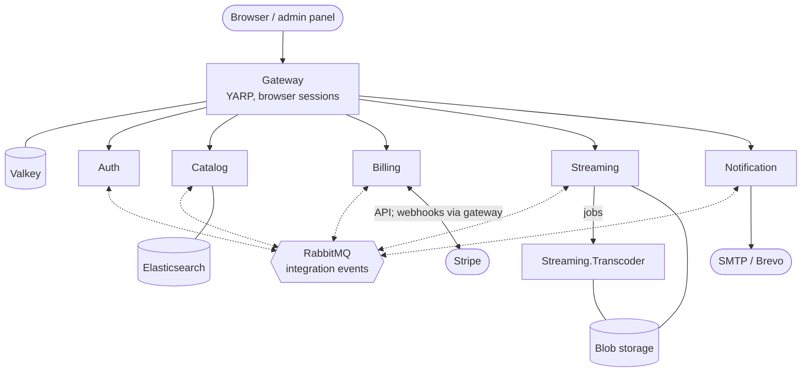

# NetBoxPlus Backend

[](https://github.com/muratc34/NetBoxPlus-Backend/actions/workflows/ci.yml)
[](LICENSE)

The backend of a subscription video streaming platform: a catalog in two languages, Stripe
subscriptions, HLS video with dubbing, subtitles, trailers, screen limits and age ratings, per-profile lists,
continue watching, ratings and recommendations, a popularity ranking, and transactional e-mail. It is built
on .NET 10 as five independently deployable services behind a YARP gateway, in a single
repository, and the whole system comes up with one command.

> This is the rewrite of an earlier graduation project (.NET 8), which is preserved under the
> [`v1-graduation`](../../tree/v1-graduation) tag. The web and admin apps live in
> [NetBoxPlus-Frontend](https://github.com/muratc34/NetBoxPlus-Frontend).

## Architecture



Services never call each other. Each owns its PostgreSQL database (the transcoder shares
Streaming's), publishes integration events through a transactional outbox, and keeps a local copy
of what it needs from other services. Browsers upload videos and fetch HLS segments directly from
blob storage with short-lived SAS URLs.

| Service | Responsibility | Publishes | Consumes |
|---|---|---|---|
| **Auth** | Accounts, profiles, roles and permissions, access and refresh tokens, e-mail verification and change, password reset, account deletion | `UserRegistered`, `Profile*`, `EmailVerificationRequested`, `EmailVerified`, `EmailChangeRequested`, `EmailChanged`, `PasswordResetRequested`, `PasswordChanged`, `UserDeleted` | — |
| **Catalog** | Movies, series, people and genres in Turkish and English; full-text search; publishing rules; audio and subtitle languages; sorting by popularity; filters by age rating and by id | `PlayableChanged` | `Video*`, `PopularityUpdated` |
| **Billing** | Plans, Stripe Checkout and customer portal, a mirror of Stripe subscriptions and invoices | `Subscription*`, `PaymentFailed` | `UserRegistered`, `EmailVerified`, `EmailChanged`, `UserDeleted` |
| **Streaming** | Video upload and transcoding, dubbing and subtitles, trailers, playback sessions, screen limits, watch progress, My List, popularity | `Video*`, `PopularityUpdated` | `Profile*`, `Subscription*`, `PlayableChanged`, `UserDeleted` |
| **Notification** | Queued, retried transactional e-mail | — | `UserRegistered`, `EmailVerificationRequested`, `EmailChangeRequested`, `EmailChanged`, `PasswordResetRequested`, `PasswordChanged`, `UserDeleted`, `SubscriptionActivated`, `SubscriptionCanceled`, `PaymentFailed` |
| **Gateway** | Routing, CORS and rate limits per route group, cookie sessions for browsers, rate limits per visitor for the web app's server rendering | — | — |

### Key flows

**From sign-up to playback.** The browser registers through the gateway and gets a session
cookie. Auth publishes `EmailVerificationRequested` and Notification mails the link. Checkout is
refused until the address is verified, which Billing learns from `EmailVerified`. After payment,
Stripe's webhook updates Billing's mirror, and `SubscriptionActivated` reaches Streaming. When a
profile starts a title, Streaming decides on its own local copies (profile, subscription, playable
content, age rating, free screens) and returns signed HLS playlists capped at the plan's quality.

**From upload to a published title.** An administrator uploads the source file straight to blob
storage with a short-lived SAS URL and confirms it. The transcoder takes the job from a Postgres
queue (`SKIP LOCKED` with a lease), produces 360p/720p/1080p HLS without upscaling, and Streaming
publishes `VideoReady`. Catalog will not publish a movie or an episode until its video is
playable, and announces every change to Streaming with `PlayableChanged`.

**Dubbing and subtitles.** New videos keep their sound apart from the picture, so a dub in another
language (`tr-TR`, `en-US`, …) is uploaded and transcoded on its own and must match the video's
length. Subtitles are uploaded as WebVTT or SRT and stored as WebVTT. The master playlist lists
every language, and the profile's saved choice decides which are on by default. Catalog learns the
languages from `VideoTracksChanged` and shows them on the title.

**Popularity.** Streaming counts each profile once a day per title over the last seven days,
keeping only the daily totals, and publishes the top 100 with `PopularityUpdated` when it changes.
Catalog sorts titles by it and lets it lift popular titles slightly in search.

**Recommendations.** A profile rates titles (not for me, like, love), and Streaming turns its ratings
and watching into a taste: title ids it is drawn to and away from. The web app passes them to Catalog,
which finds similar titles with Elasticsearch's `more_like_this` over genres, people, synopsis and
title, leaving out what the profile has seen. Catalog never learns who the profile is, and no service
calls another. Removing a title from the watching history removes it from the taste too.

**Account deletion.** Auth anonymizes the account and publishes `UserDeleted`. Billing deletes the
Stripe customer, which cancels the subscription at once, and keeps the invoices without card
details. Streaming removes profiles, lists and watch progress and ends open sessions. Notification
sends a farewell e-mail and empties the others. The address can be registered again.

## Engineering highlights

- **Clean Architecture per service** (Domain → Application → Infrastructure → API), enforced by
  architecture tests. CQRS with an in-house dispatcher and pipeline behaviors for validation,
  transactions and audit; handlers return `Result`, HTTP errors are RFC 9457 problem details.
- **Reliable messaging:** transactional outbox and idempotent inbox over RabbitMQ, retries with a
  dead-letter queue, revisions on every replicated record so that late or repeated events are
  ignored. Under load, restarting RabbitMQ and stopping Notification for a minute lost none of 480
  sign-ups' events.
- **Browser sessions without tokens in the browser:** the gateway keeps the tokens encrypted in
  Valkey and gives the browser an httpOnly `__Host-` cookie plus a CSRF token. Access tokens are
  ES256 JWTs (`at+jwt`, 15 minutes) verified against Auth's JWKS; a reused refresh token revokes
  its whole family.
- **Payments:** Stripe is the source of truth, Billing mirrors it from verified webhooks. Payment
  endpoints require an `Idempotency-Key`; amounts are integer minor units; only the card brand and
  last four digits are stored.
- **Playback rules:** HMAC-signed playlists, read-only SAS for segments, a screen limit enforced
  with optimistic concurrency, heartbeats that re-check the rules.
- **Observability:** OpenTelemetry traces, metrics and logs with redaction of personal data;
  service metrics (sign-ins, outbox and dead-letter depth, transcoding, playback, ratings and
  recommendations, e-mail) and a
  provisioned Grafana dashboard. Lost or stuck events turn health checks `Degraded` and log an error.
- **Tests against real infrastructure:** over 1,300 tests; integration tests run PostgreSQL,
  RabbitMQ and Azurite in containers (Testcontainers), and transcoding tests run real ffmpeg. The
  frontend repository drives the whole system end to end with Playwright, from sign-up and a
  Stripe test payment to playback, and from an upload in the admin panel to a published title.
- **Measured:** a mixed k6 scenario (browsing, playback with heartbeats, one sign-up per second)
  ran at about 36 requests/s with a p95 of 24 ms and 0.01% errors, on a Ryzen 5 3600 running the
  whole system and k6 in Docker Desktop. Its slowest requests are password hashing
  (PBKDF2-SHA512, 210,000 iterations — deliberately expensive).

## Quick start

Requires Docker Desktop and PowerShell. Nothing else is installed on the host.

```powershell
./deploy/dev.ps1 up -App
```

The first run creates `deploy/.env` (ignored by git) with random passwords and signing keys,
builds every image and waits until all services report ready. Then fill the catalog:

```powershell
./deploy/dev.ps1 seed
```

The seeder signs in as the administrator through the gateway, like the admin panel, and creates
genres, people, six movies and two series with generated posters and 30-second videos, a dub,
subtitles in two languages and two trailers, waits for transcoding and publishes them (about four
minutes; running it again changes nothing). With a Stripe key it also creates two plans.

The web app and the admin panel are in
[NetBoxPlus-Frontend](https://github.com/muratc34/NetBoxPlus-Frontend): with this system running,
`pnpm dev` there serves them on http://localhost:5173 and http://localhost:5174.

| What | Where |
|---|---|
| Gateway (the only address a browser needs) | http://localhost:5100 |
| E-mails (Mailpit) | http://localhost:8025 |
| Logs, traces, metrics (Aspire dashboard) | http://localhost:18888 |
| RabbitMQ management | http://localhost:15672 |
| Grafana (with `up -App -Observability`) | http://localhost:3000 |

The administrator is `AUTH_ADMIN_EMAIL` with `AUTH_ADMIN_PASSWORD` from `deploy/.env`.

**Payments are optional.** Without a Stripe key everything works except the payment endpoints,
which answer `503`. To try subscriptions, put a test-mode key (`sk_test_…`) in `deploy/.env` as
`STRIPE_SECRET_KEY` before `seed` (it then creates the plans in Stripe too), and forward Stripe's
webhooks with the [Stripe CLI](https://docs.stripe.com/stripe-cli):

```bash
stripe listen --api-key <STRIPE_SECRET_KEY> --print-secret
```

Store that value as `STRIPE_WEBHOOK_SECRET` in `deploy/.env`, run `up -App` again, and keep the
listener running:

```bash
stripe listen --api-key <STRIPE_SECRET_KEY> --events checkout.session.completed,customer.subscription.created,customer.subscription.updated,customer.subscription.deleted,invoice.finalized,invoice.paid,invoice.payment_failed,invoice.voided,invoice.marked_uncollectible --forward-to localhost:5100/billing/webhooks/stripe
```

E-mail goes to Mailpit unless `deploy/.env` sets `EMAIL_PROVIDER=Brevo` with `BREVO_API_KEY` and
`EMAIL_FROM`.

```powershell
./deploy/dev.ps1 status
./deploy/dev.ps1 down           # stop, keep data
./deploy/dev.ps1 reset -Force   # stop and delete all local data
```

## Development

### Build and test

Requires the .NET 10 SDK (pinned in `global.json`).

```bash
dotnet build NetBoxPlus.slnx
```

```bash
dotnet test --solution NetBoxPlus.slnx
```

Tests run on Microsoft.Testing.Platform. Integration tests need Docker, and the transcoding and
seeder tests need ffmpeg (`FFMPEG_DIRECTORY` or `PATH`; on Windows `winget install Gyan.FFmpeg`).
Locally, tests whose prerequisites are missing are reported as skipped; in CI they fail.

### Running a service from the IDE

Start only the dependencies, write their settings into the services' user secrets, then run a
service's migrator and API. `src/Services/Auth` is the reference every other service follows.

```powershell
./deploy/dev.ps1 up -Search
./deploy/dev.ps1 secrets
dotnet run --project src/Services/Auth/Auth.Migrator
dotnet run --project src/Services/Auth/Auth.API --launch-profile Auth.API
dotnet run --project src/Gateway/Gateway --launch-profile Gateway
```

| Process | Port | Process | Port |
|---|---|---|---|
| Gateway | 5100 | Streaming | 5106 |
| Auth | 5103 | Notification | 5107 |
| Catalog | 5104 | Streaming.Transcoder | — |
| Billing | 5105 | | |

Each API serves its OpenAPI document at `/openapi/v1.json` in development; the build writes them
to [`docs/openapi/`](docs/openapi).

| Dependency | Address |
|---|---|
| PostgreSQL 18 (a database and a role per service) | `localhost:5432` |
| RabbitMQ 4 | `localhost:5672`, http://localhost:15672 |
| Valkey 9 | `localhost:6379` |
| Azurite (blob storage) | `localhost:10000` |
| Elasticsearch 9 (with `-Search`) | http://localhost:9200 |
| Mailpit | SMTP `localhost:1025`, http://localhost:8025 |
| Aspire dashboard | http://localhost:18888, OTLP `localhost:4317` |

All ports are bound to `127.0.0.1`, images are pinned to versions, and credentials exist only in
`deploy/.env`.

### Load tests

[k6](https://k6.io) scenarios live in `deploy/load/` and run in a container against the gateway.
`prepare` creates subscribed test accounts once (Stripe test mode; it starts the Stripe CLI
itself), then `load` runs the `mixed` scenario (or `browse`, `watch`) and writes a summary to
`deploy/load/results/`.

```powershell
./deploy/dev.ps1 load -Scenario prepare
./deploy/dev.ps1 load
```

## Repository layout

```
src/BuildingBlocks/   Shared.Domain, Shared.Application, Shared.Infrastructure.{API,Persistence,Messaging}
src/Services/<S>/     <S>.Domain, .Application, .Infrastructure, .API, .Contracts, .Migrator
src/Gateway/          YARP gateway and browser sessions
src/Tools/            NetBoxPlus.DemoSeeder
tests/                same layout as src/, plus architecture tests
deploy/               compose.yaml, dev.ps1, load tests, Grafana provisioning
docs/openapi/         generated OpenAPI documents
```

A service may reference another service only through its `*.Contracts` project, which holds the
event records.

## Continuous integration

[CI](.github/workflows/ci.yml) runs on every push and pull request to `master`: a
Release build with warnings as errors, a check that `docs/openapi/` matches the build output, all
tests with Docker and ffmpeg required, and a build of every container image. Actions are pinned
to commit SHAs; Dependabot updates actions and NuGet packages weekly.

## License

[MIT](LICENSE)
